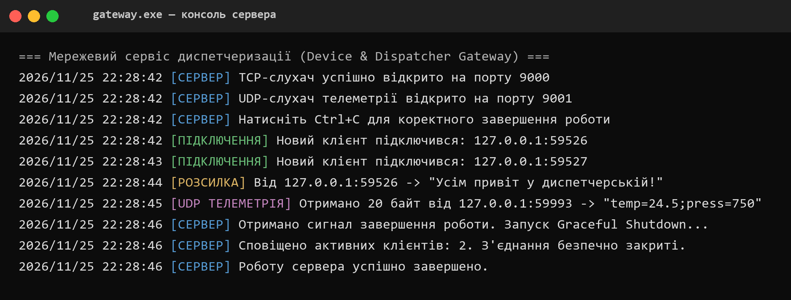
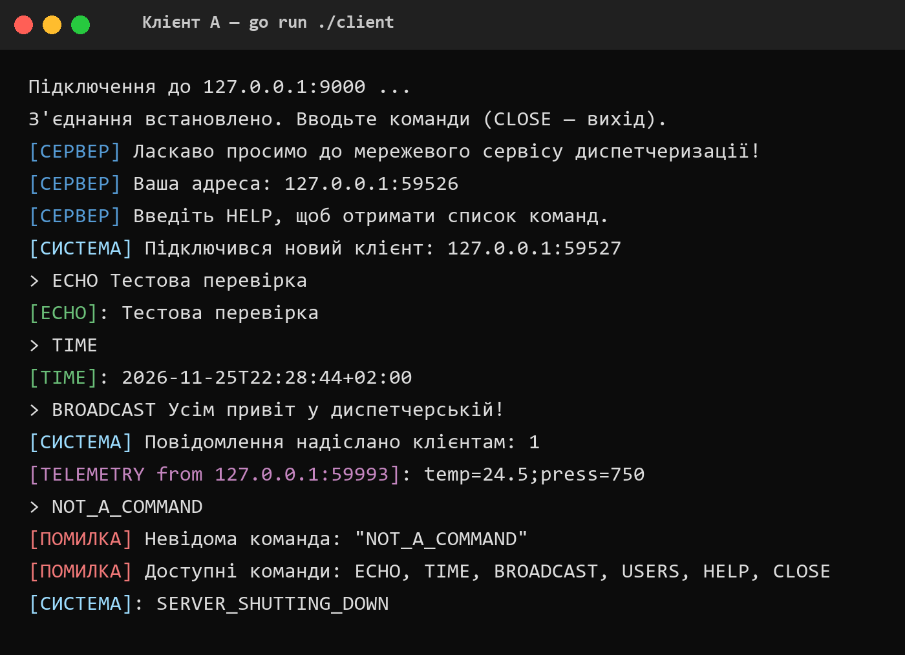
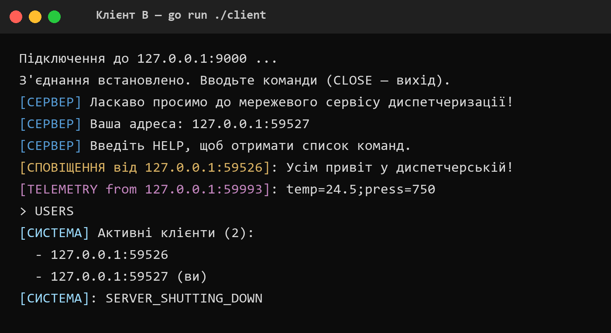
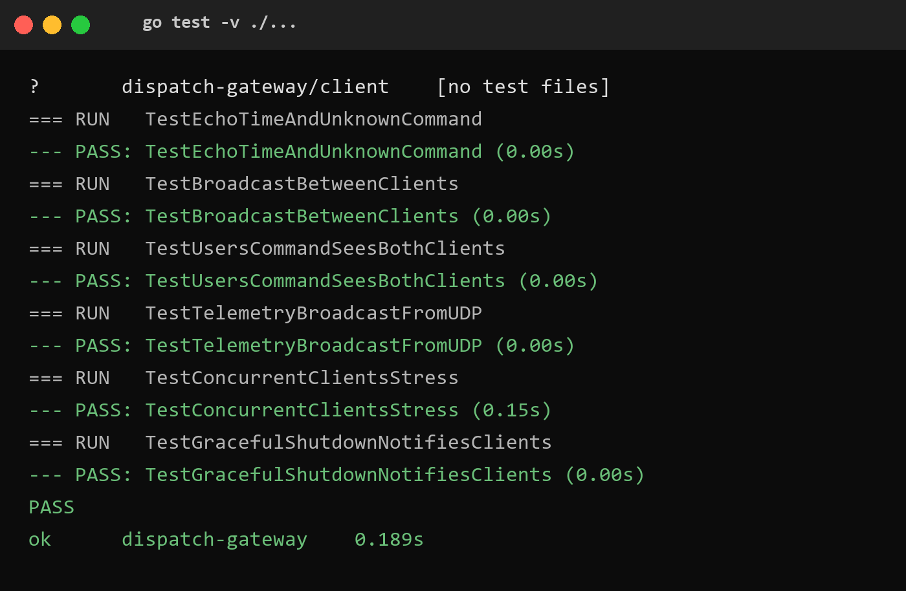

# Практична робота № 2. Сокетне програмування та обмін повідомленнями по TCP/UDP

**Тема:** мережевий сервіс диспетчеризації та телеметрії (Device & Dispatcher Gateway)
**Мова:** Go 1.22+
**Модуль:** `dispatch-gateway`

---

## 1. Мета роботи

- опанувати низькорівневе сокетне програмування засобами пакета `net`;
- реалізувати багатопотоковий TCP-сервер за моделлю «горутина на кожне з'єднання»;
- спроєктувати текстовий протокол прикладного рівня з розділювачем рядків;
- забезпечити потокобезпечну реєстрацію клієнтів і широкомовну розсилку (Broadcast);
- приймати UDP-датаграми телеметрії та транслювати їх TCP-клієнтам;
- реалізувати плавне завершення роботи сервера (Graceful Shutdown) за сигналом ОС.

## 2. Що реалізовано

| Рівень | Вимога | Стан |
|---|---|---|
| 1 | TCP-слухач `net.Listen`, цикл `Accept()`, горутина на клієнта | ✅ |
| 1 | Протокол з `bufio.NewReader` + `ReadString('\n')`, `TrimSpace` | ✅ |
| 1 | Команди `ECHO`, `TIME`, `CLOSE`/`QUIT`, обробка невідомих команд | ✅ |
| 2 | Реєстр клієнтів `map[*Client]struct{}` під `sync.RWMutex` | ✅ |
| 2 | `BROADCAST`/`MSG` усім іншим клієнтам | ✅ |
| 2 | Системні сповіщення про підключення та відключення | ✅ |
| 2 | Захист від гонок, гарантоване видалення клієнта через `defer` | ✅ |
| 3 | UDP-приймач `net.ListenPacket("udp", ...)`, цикл `ReadFrom` | ✅ |
| 3 | Трансляція телеметрії з міткою `[TELEMETRY from ...]` | ✅ |
| 3 | Graceful Shutdown за `SIGINT`/`SIGTERM` з повідомленням `SERVER_SHUTTING_DOWN` | ✅ |

Додатково (понад мінімум): команда `USERS`, команда `HELP`, неблокуючі черги
відправлення на кожного клієнта, дедлайни запису, автоматичні інтеграційні
тести та власний консольний клієнт `client/`.

---

## 3. Архітектура застосунку

### 3.1. Загальна схема

```text
                 TCP :9000                              UDP :9001
   ┌──────────┐  команди/сповіщення      ┌──────────┐   датаграми телеметрії
   │ Клієнт A │◄───────────────────────►│          │◄───────────────────────
   └──────────┘                         │          │        (сенсори)
   ┌──────────┐                         │ Gateway  │
   │ Клієнт B │◄───────────────────────►│ (Go)     │
   └──────────┘                         │          │
   ┌──────────┐                         │          │
   │ Клієнт C │◄───────────────────────►│          │
   └──────────┘                         └──────────┘
```

Сервер одночасно тримає два слухачі:

- **TCP :9000** — довготривалі з'єднання диспетчерів: команди, розсилка,
  системні сповіщення;
- **UDP :9001** — «швидкий» канал телеметрії без встановлення з'єднання.

### 3.2. Горутини та потоки даних

```text
main
 ├── acceptLoop()                 — приймає нові TCP-з'єднання
 │     └── handleConn(conn)       — окрема горутина на кожного клієнта
 │           ├── writeLoop()      — єдина горутина, що пише в conn
 │           └── читає команди через ReadString('\n')
 ├── telemetryLoop()             — читає UDP-датаграми (ReadFrom)
 └── очікування сигналу ОС → Shutdown(ctx)
```

Ключові структури (`server.go`):

```go
type Client struct {
    conn       net.Conn
    addr       string
    send       chan string   // буферизована черга вихідних повідомлень
    sendMu     sync.Mutex    // захищає закриття каналу
    sendOpen   bool
    writerDone chan struct{}
}

type Server struct {
    mu           sync.RWMutex          // захищає clients
    clients      map[*Client]struct{}  // реєстр активних підключень
    tcpListener  net.Listener
    udpConn      net.PacketConn
    wg           sync.WaitGroup        // усі обслуговуючі горутини
    shuttingDown atomic.Bool
    shutdownOnce sync.Once
}
```

### 3.3. Ключові архітектурні рішення (і навіщо вони)

1. **«Горутина на кожне з'єднання».** Код обробника пишеться послідовно
   (читання → обробка → відповідь), без callback-ів і станів. Горутини дешеві,
   тому 100+ одночасних клієнтів для навчального сервера — не проблема.

2. **Окрема черга `send` і горутина-письменник на клієнта.** Розсилка не робить
   `conn.Write` під замком реєстру. Якщо один клієнт «завис» (не читає),
   решта продовжують працювати, а повільний клієнт отримує відмову в черзі
   (`enqueue` повертає `false`) замість блокування всього сервера.

3. **Один письменник на з'єднання.** TCP-потік не має меж повідомлень, тому
   паралельні `Write` із різних горутин могли б перемішати байти двох
   повідомлень. `writeLoop` — єдине місце запису.

4. **`sync.RWMutex` + копіювання списку перед розсилкою.** Під `RLock`
   знімається зріз покажчиків, замок одразу відпускається, і лише потім
   виконується `enqueue`. Це зменшує час утримання замка та виключає
   взаємоблокування з `Shutdown`.

5. **`atomic.Bool` для прапорця зупинки.** Перевіряється в циклах `Accept`,
   `ReadFrom` і при реєстрації; не потребує замка й не створює гонки.

6. **Graceful Shutdown через `signal.Notify`.** Сервер не «падає» за сигналом,
   а проходить контрольовану послідовність:
   закрити слухачі → надіслати `SERVER_SHUTTING_DOWN` → закрити черги
   (письменники дописують залишок і закривають з'єднання) → `wg.Wait()`
   з таймаутом 5 с.

### 3.4. Структура проєкту

```text
.
├── go.mod                 # модуль dispatch-gateway, Go 1.22
├── main.go                # точка входу: прапорці, запуск, сигнали, shutdown
├── server.go              # Server, Client, acceptLoop, реєстр, broadcast, UDP, Shutdown
├── commands.go            # розбір і виконання команд протоколу
├── server_test.go         # інтеграційні тести (6 сценаріїв)
├── client/main.go         # власний консольний TCP-клієнт для демонстрації
├── docs/
│   ├── logs/              # реальні логи запуску (server.log, client_A.log, ...)
│   └── screenshots/       # зображення консолі для звіту
├── README.md
└── .gitignore
```

Розділення на файли зроблено за відповідальністю: транспорт і стан сервера
(`server.go`), бізнес-логіка команд (`commands.go`), запуск процесу (`main.go`).
Це дозволяє тестувати сервер як звичайний Go-об'єкт (`NewServer` + `Start`),
не запускаючи `main`.

---

## 4. Протокол прикладного рівня

- Кодування: **UTF-8**.
- Одиниця передачі: **рядок**, термінатор — `\r\n` (сервер приймає і `\n`).
- Максимальна довжина рядка: **4096 байт**.
- Команда — перше слово до пробілу, регістр не важливий.
- Аргумент — увесь залишок рядка (пробіли всередині зберігаються).
- Сервер відповідає рядками з префіксами `[СЕРВЕР]`, `[ECHO]`, `[TIME]`,
  `[СИСТЕМА]`, `[СПОВІЩЕННЯ від ...]`, `[TELEMETRY from ...]`, `[ПОМИЛКА]`.

| Команда | Дія | Приклад відповіді |
|---|---|---|
| `ECHO <текст>` | повертає текст відправнику | `[ECHO]: Тестова перевірка` |
| `TIME` | поточний час сервера | `[TIME]: 2026-11-25T22:28:44+02:00` |
| `BROADCAST <текст>` / `MSG <текст>` | надсилає текст усім **іншим** клієнтам | відправнику: `[СИСТЕМА] Повідомлення надіслано клієнтам: 1`; іншим: `[СПОВІЩЕННЯ від 127.0.0.1:59526]: ...` |
| `USERS` | список активних підключень | `[СИСТЕМА] Активні клієнти (2): ...` |
| `HELP` | довідка | список команд |
| `CLOSE` / `QUIT` | прощання і закриття з'єднання | `[СЕРВЕР] До побачення! ...` |
| інше | помилка з підказкою | `[ПОМИЛКА] Невідома команда: "..."` |

Системні події (надсилаються автоматично):

```text
[СЕРВЕР] Ласкаво просимо до мережевого сервісу диспетчеризації!
[СИСТЕМА] Підключився новий клієнт: 127.0.0.1:59527
[СИСТЕМА] Клієнт відключився: 127.0.0.1:59527
[TELEMETRY from 127.0.0.1:59993]: temp=24.5;press=750
[СИСТЕМА]: SERVER_SHUTTING_DOWN
```

---

## 5. Запуск

### 5.1. Вимоги

- Go SDK 1.22 або новіший;
- будь-який термінал (PowerShell, bash, zsh);
- за бажанням — `nc`/`telnet`/Ncat або вбудований клієнт `client/`.

### 5.2. Сервер

```bash
go run .
```

Порти за замовчуванням — TCP `:9000`, UDP `:9001`. Їх можна змінити:

```bash
go run . -tcp :8080 -udp :8081
```

Зупинка — `Ctrl+C` (SIGINT). На Linux/macOS також працює `SIGTERM`:

```bash
kill -TERM <pid>
```

### 5.3. Клієнт

Вбудований консольний клієнт (зручно на Windows, де часто немає `nc`):

```bash
go run ./client -addr 127.0.0.1:9000
```

Або стандартні утиліти:

```bash
nc localhost 9000            # Linux/macOS
telnet localhost 9000        # Windows/Linux
```

### 5.4. Надсилання UDP-телеметрії

Linux/macOS:

```bash
printf 'temp=24.5;press=750\n' | nc -u localhost 9001
```

Windows PowerShell (без netcat):

```powershell
$udp = New-Object System.Net.Sockets.UdpClient
$data = [Text.Encoding]::UTF8.GetBytes("temp=24.5;press=750")
$udp.Send($data, $data.Length, "127.0.0.1", 9001)
$udp.Close()
```

---

## 6. Демонстрація роботи

Нижче — реальний вивід програми, збережений під час запуску
(повні логи лежать у [`docs/logs`](docs/logs)). Зображення сформовані з цих
логів, щоб текст залишався читабельним.

### 6.1. Консоль сервера



### 6.2. Клієнт A



### 6.3. Клієнт B



Що демонструють ці три консолі:

1. два незалежні TCP-клієнти підключені одночасно;
2. `ECHO` і `TIME` працюють для кожного окремо;
3. `BROADCAST` від клієнта A отримав клієнт B (і навпаки — розсилка не йде
   відправнику, але він отримує підтвердження кількості одержувачів);
4. `USERS` показує обидва підключення;
5. UDP-датаграма `temp=24.5;press=750` миттєво транслювалася обом TCP-клієнтам;
6. невідома команда повернула помилку з підказкою;
7. після сигналу завершення обидва клієнти отримали `SERVER_SHUTTING_DOWN`,
   а сервер закрив слухачі та з'єднання й завершився з кодом 0.

### 6.4. Автоматичні тести

```bash
go test -v ./...
```



Тести піднімають справжній сервер на портах `127.0.0.1:0` (ОС сама обирає
вільний порт), підключаються реальними TCP/UDP-сокетами і перевіряють
протокол, розсилку, телеметрію, конкурентне навантаження та shutdown.

---

## 7. Діагностика потокобезпечності

### 7.1. `go vet` і стрес-тест

```bash
go vet ./...
go test -v ./...
```

`TestConcurrentClientsStress` створює 10 клієнтів, які одночасно надсилають
`ECHO`, `BROADCAST` та `USERS`, паралельно надсилає 20 UDP-датаграм, після чого
виконує `Shutdown`. Тест проходить без панік і взаємних блокувань
(результат — на скріншоті вище).

### 7.2. Детектор гонок (`-race`)

```bash
go run -race .
go test -race ./...
```

Детектор гонок Go потребує **cgo та 64-бітного компілятора C** (MinGW-w64 /
GCC). На машині, де знімалися логи, встановлений 32-бітний MinGW.org GCC 6.3,
тому `-race` там недоступний (`cc1.exe: sorry, unimplemented: 64-bit mode not
compiled in`). Якщо у вас 64-бітний GCC (наприклад, з MSYS2:
`pacman -S mingw-w64-x86_64-gcc`), команда вище запускається без додаткових
налаштувань; очікуваний результат — `PASS` без рядків `WARNING: DATA RACE`.

Примітка: на Linux/macOS `-race` працює «з коробки», без окремого GCC.

---

## 8. Пояснення архітектури для захисту

### 8.1. Чому саме `map` + `RWMutex`?

`map` у Go не безпечний для одночасного запису: одночасний запис із кількох
горутин — це не «втрачене оновлення», а фатальна помилка середовища
виконання (`concurrent map writes`), яку не можна перехопити. Тому всі
операції з `clients` виконуються під замком:

- `addClient` / `removeClient` — `Lock()` (зміна складу);
- `handleUsers` / `broadcast` — `RLock()` (читання, можуть іти паралельно).

`RWMutex` обраний, бо читань (розсилка, `USERS`) значно більше, ніж змін.

### 8.2. Чому розсилка не тримає замок під час `Write`?

Якби `broadcast` викликав `conn.Write` під `Lock()`, то один клієнт із
переповненим TCP-вікном зупинив би і прийом нових підключень, і `USERS`,
і `Shutdown`. Тому під замком лише копіюється список, а запис іде через
черги. Черга обмежена (`sendBuffer = 64`) — це захист від необмеженого
зростання пам'яті; при переповненні повідомлення відкидається, і сервер
продовжує працювати.

### 8.3. Як гарантується, що клієнт зникне з реєстру?

`handleConn` одразу після успішної реєстрації робить `defer s.removeClient(client)`.
Тому видалення відбудеться при будь-якому виході: `CLOSE`, обрив зв'язку,
помилка читання, завершення сервера.

### 8.4. Чому `sync.Once` у `Shutdown`?

`Shutdown` може бути викликаний із `main` за сигналом, із тестів або
повторно (наприклад, прибирання в тесті після явної зупинки). `sync.Once`
гарантує, що слухачі закриваються й клієнти сповіщаються рівно один раз,
а повторний виклик не панікує.

### 8.5. Як влаштований Graceful Shutdown покроково?

1. `shuttingDown.Store(true)` — нові підключення більше не реєструються.
2. Закриваються TCP- і UDP-слухачі → `Accept`/`ReadFrom` повертають
   `net.ErrClosed`, цикли коректно виходять.
3. Кожному клієнту ставиться в чергу `[СИСТЕМА]: SERVER_SHUTTING_DOWN`.
4. Черги закриваються: `writeLoop` дописує накопичене, потім закриває `conn`.
5. `wg.Wait()` чекає на `acceptLoop`, `telemetryLoop` і всі `handleConn`.
6. Якщо за 5 секунд не встигли — повертається помилка таймауту, процес
   завершується з ненульовим кодом (краще, ніж зависнути назавжди).

### 8.6. Межі застосунку та можливі покращення

- повідомлення при переповненні черги відкидаються (немає повторної доставки);
- немає автентифікації клієнтів і шифрування (для навчальної роботи достатньо,
  у продакшені — TLS та токени);
- протокол текстовий, без екранування символу `\n` в аргументі;
- для великого навантаження варто додати `SetReadDeadline`/heartbeat,
  обмеження кількості з'єднань і метрики.

---

## 9. Відповіді на контрольні питання

**1. Чим відрізняється робота з TCP-сокетом від UDP на рівні системних
викликів і пакета `net`?**

TCP — це `SOCK_STREAM`: послідовність системних викликів
`socket → bind → listen → accept → read/write → close`, ядро тримає стан
з'єднання (SEQ/ACK, повторна передача, ковзне вікно, порядок байтів).
У Go: `net.Listen("tcp", ...)` → `net.Listener` → `Accept()` → `net.Conn`
(реалізує `io.Reader`/`io.Writer`), один `Conn` = одне з'єднання.

UDP — це `SOCK_DGRAM`: `socket → bind → recvfrom/sendto → close`; з'єднання
немає, кожен пакет незалежний, адреса відправника приходить із датаграмою.
У Go: `net.ListenPacket("udp", ...)` → `net.PacketConn` → `ReadFrom`/`WriteTo`;
немає `Accept`, немає `net.Conn` на клієнта. Гарантій доставки, порядку та
цілісності потоку немає — лише контрольна сума пакета.

**2. Чому TCP не зберігає межі повідомлень і як це вирішується?**

TCP розглядає дані як безперервний потік байтів. Ядро може склеїти кілька
`Write` в один сегмент або розбити один `Write` на кілька сегментів; межі
`write()` не передаються. Тому прикладний протокол сам визначає кадрування:
- розділювач (`\n`, `\r\n`) + буферизоване читання (`bufio.ReadString`);
- префікс довжини (наприклад, 4 байти big-endian + тіло) — бінарно-безпечно;
- фіксована довжина запису.
У цій роботі використано `\r\n` і `ReadString('\n')`: просто, читабельно
для `nc`/`telnet` і достатньо для текстових команд. Обмеження — символ
розділювача не можна передати в тексті без екранування.

**3. Чому «горутина на кожне з'єднання» — природна й масштабована модель у Go?**

Горутина — це легковажний потік виконання з початковим стеком ~2–8 КБ, який
росте за потреби; планувальник Go виконує багато горутин на невеликій
кількості потоків ОС (модель M:N). Перемикання між горутинами відбувається
в просторі користувача й коштує значно дешевше, ніж перемикання потоків ОС
(у яких стек 1–8 МБ і планування в ядрі). Мережеві виклики в Go
неблокуючі: `netpoller` (epoll/kqueue/IOCP) паркує горутину, не займаючи
потік ОС. Тому десятки тисяч з'єднань — реальні, а код обробника залишається
лінійним і читабельним, без callback-ів.

**4. Навіщо `sync.Mutex`/`sync.RWMutex` для списку клієнтів?**

`map` не призначений для конкурентного доступу. Одночасний запис у `map`
призводить до фатальної помилки `concurrent map writes`; читання під час
запису — до `concurrent map iteration and map write` або до некоректних
даних (наприклад, щойно видалений клієнт залишається в списку й отримує
розсилку, або новий клієнт «губиться»). Замок серіалізує зміни й дає
коректний знімок списку. `RWMutex` дозволяє кільком читачам працювати
паралельно (розсилка й `USERS`), блокування — лише на час зміни складу.

**5. Коли UDP доцільніший за TCP?**

- телеметрія/сенсори з високою частотою: втрата одного пакета не критична,
  а затримка критична;
- VoIP, відеоконференції, онлайн-ігри, стрімінг — краще втратити кадр,
  ніж чекати повторної передачі;
- DNS, DHCP, NTP, SNMP, multicast/broadcast-опитування;
- системи, де клієнт надсилає короткі незалежні повідомлення без сесії.
  TCP доцільніший там, де потрібна гарантована доставка й порядок:
  команди керування, файли, транзакції, автентифікація.

**6. Як працює перехоплення сигналів і чому потрібен Graceful Shutdown?**

`signal.Notify(ch, os.Interrupt, syscall.SIGTERM)` реєструє канал, у який
середовище виконання надсилає сигнали; на Unix встановлюється обробник
`SIGINT`/`SIGTERM`, на Windows — `SetConsoleCtrlHandler`, який перетворює
Ctrl+C/Ctrl+Break на `os.Interrupt`. Канал має буфер ≥1, щоб сигнал не
загубився до читання. Graceful Shutdown потрібен, щоб: не обірвати активні
з'єднання посеред відповіді, повідомити клієнтів, коректно закрити сокети
(без RST), дочекатися горутин і не втратити дані. В оркестраторах
(Kubernetes, systemd) сервісу дають час саме на таку зупинку за SIGTERM.

**7. Чи працюватимуть клієнти іншими мовами?**

Так. TCP/UDP — стандартні протоколи ОС, а наш протокол — це UTF-8 текст із
термінатором `\r\n`; жодних Go-специфічних форматів (gob, JSON-структур Go)
немає. C#, Java, Python, Kotlin можуть підключитися звичайним `TcpClient`
і надсилати рядки. Важливо лише домовитися про кодування, термінатор,
регістр команд і формат відповідей (див. розділ 4). Для бінарного протоколу
додатково знадобився б узгоджений порядок байтів (network byte order).

---

## 10. Висновки

У роботі реалізовано повноцінний мережевий сервіс, який поєднує два типи
взаємодії: надійний потоковий TCP для команд і розсилки та дейтаграмний UDP
для телеметрії. Опановано роботу з `net.Listener`/`net.PacketConn`,
буферизованим потоковим вводом-виводом, текстовими протоколами з
розділювачем, конкурентним доступом до спільного стану та плавним
завершенням процесу. Архітектура з окремою горутиною-письменником і
неблокуючими чергами дозволяє серверу залишатися чуйним навіть за повільного
клієнта, а автоматичні інтеграційні тести підтверджують коректність
протоколу, розсилки, телеметрії та shutdown-сценарію.

---

## 11. Як перевірити роботу самостійно (короткий чек-ліст)

1. `go vet ./...` — без зауважень.
2. `go test -v ./...` — усі тести `PASS`.
3. `go run .` — у консолі два рядки про відкриті TCP/UDP-порти.
4. `go run ./client` у двох терміналах → `USERS` показує два клієнти.
5. `BROADCAST привіт` в одному → другий бачить `[СПОВІЩЕННЯ від ...]`.
6. Надіслати UDP-датаграму (див. 5.4) → обидва клієнти бачать `[TELEMETRY ...]`.
7. `Ctrl+C` у консолі сервера → клієнти отримують `SERVER_SHUTTING_DOWN`,
   сервер пише `Роботу сервера успішно завершено.`
